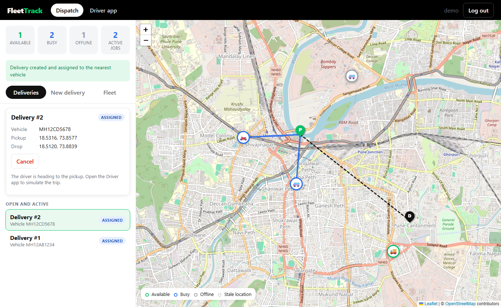

# FleetTrack

[](https://github.com/tusharpatange18-beep/FleetTrack/actions/workflows/ci.yml)

A Spring Boot backend for running a delivery fleet. Dispatchers register vehicles and drivers, track vehicle positions, create deliveries, and assign them manually or automatically to the nearest suitable vehicle. A strict state machine and row-level locking keep the data consistent when several dispatchers work at the same time.

**Web UI:** an Uber-style dispatcher console and driver app live in [`frontend/`](frontend/README.md) (React, TypeScript, Leaflet).



**Stack:** Java 21 · Spring Boot 3.5 (Web, Data JPA, Security, Validation, Actuator) · MySQL 8 · Flyway · JWT (jjwt) · springdoc OpenAPI · JUnit 5, Mockito, Testcontainers, JaCoCo · Docker · GitHub Actions

---

## Features

- **Vehicles:** CRUD with soft delete. Each vehicle has a status (`AVAILABLE`, `BUSY`, `OFFLINE`, `INACTIVE`). Users can set only `AVAILABLE` and `OFFLINE`; the delivery flow owns `BUSY`, and `DELETE` sets `INACTIVE`.
- **Drivers:** CRUD with soft delete. A driver is linked to at most one vehicle and can be unlinked. Deactivating a driver unlinks them, but not while their vehicle is on a delivery.
- **Location tracking:** `PATCH /location` updates the current position and appends a row to an audit trail. `GET /locations` returns that trail, newest first, optionally limited to a time window.
- **Nearby search:** lists AVAILABLE vehicles within a radius, nearest first. Vehicles whose last ping is older than 15 minutes (configurable) are left out, because their position can't be trusted.
- **Auto-assignment:** `POST /api/deliveries/{id}/auto-assign` assigns the nearest vehicle that can actually take the job: AVAILABLE, with an ACTIVE driver, with a fresh location, and within the radius of the pickup point.
- **Deliveries:** each delivery has its own pickup and drop coordinates, which default to the customer's saved addresses. The lifecycle is enforced as a state machine (see below).
- **Dashboard:** counts of vehicles and deliveries by status, active deliveries, and active drivers.
- **Security:** stateless JWT with two roles (`ADMIN`, `DISPATCHER`) and BCrypt password hashing. Login is rate-limited per IP. CORS accepts an allow-list of origins only.
- **Operations:** Actuator health and liveness/readiness probes, `dev` and `prod` profiles, a multi-stage non-root Docker image, Compose for the full stack, and CI that tests against real MySQL.

## Architecture

```
Client (Swagger UI / Postman / frontend)
        |  HTTPS + Bearer JWT
        v
+---------------- Spring Boot ----------------+
| LoginRateLimitFilter -> JwtAuthenticationFilter -> Spring Security (roles)
|        |
|   Controllers  (validation, DTOs; GlobalExceptionHandler -> ApiError JSON)
|        |
|   Services     (business rules, state machine, @Transactional, row locks)
|        |               \
|        |            ProximitySearch (bounding box in SQL + Haversine in Java)
|   Repositories (Spring Data JPA; SELECT ... FOR UPDATE; projections)
+--------|-------------------------------------+
         v
       MySQL 8  (schema owned by Flyway migrations)
```

## Delivery state machine

```
CREATED --assign / auto-assign--> ASSIGNED --> PICKED_UP --> IN_TRANSIT --> DELIVERED
   |                                  |
   +------------> CANCELLED <---------+
```

- `CREATED -> ASSIGNED` happens only through `/assign` or `/auto-assign`, because that step needs a vehicle. The status endpoint rejects `ASSIGNED` with 400.
- Any other jump returns 409. `DELIVERED` and `CANCELLED` are terminal.
- Assignment makes the vehicle `BUSY`. Reaching `DELIVERED` or `CANCELLED` makes it `AVAILABLE` again.

## API

Every endpoint except `/api/auth/**`, `/actuator/health` and Swagger needs `Authorization: Bearer <token>`.

| Method | Endpoint | Access |
|---|---|---|
| POST | `/api/auth/register`, `/api/auth/login` | Public (login is rate-limited) |
| GET, POST | `/api/vehicles` | ADMIN, DISPATCHER |
| GET, PATCH, DELETE | `/api/vehicles/{id}` | ADMIN, DISPATCHER |
| PATCH | `/api/vehicles/{id}/location` | ADMIN, DISPATCHER |
| GET | `/api/vehicles/{id}/locations?from=&to=&page=&size=` | ADMIN, DISPATCHER |
| GET | `/api/vehicles/nearby?latitude=&longitude=&radiusKm=10` | ADMIN, DISPATCHER |
| GET | `/api/drivers`, `/api/drivers/{id}` | ADMIN, DISPATCHER |
| POST, PATCH, DELETE | `/api/drivers`, `/api/drivers/{id}` | ADMIN |
| PATCH | `/api/drivers/{driverId}/assign-vehicle/{vehicleId}` | ADMIN |
| DELETE | `/api/drivers/{driverId}/vehicle` (unassign) | ADMIN |
| GET, POST | `/api/deliveries`, GET `/api/deliveries/{id}` | ADMIN, DISPATCHER |
| PATCH | `/api/deliveries/{id}/assign?vehicleId=` | ADMIN, DISPATCHER |
| POST | `/api/deliveries/{id}/auto-assign?radiusKm=` | ADMIN, DISPATCHER |
| PATCH | `/api/deliveries/{id}/status` | ADMIN, DISPATCHER |
| GET, POST | `/api/customers`, GET `/api/customers/{id}` | ADMIN, DISPATCHER |
| GET | `/api/dashboard/summary` | ADMIN, DISPATCHER |
| GET | `/actuator/health`, `/actuator/health/liveness`, `/actuator/health/readiness` | Public |

Registration: new accounts default to `DISPATCHER`. Only an authenticated admin can create an `ADMIN`, except for the very first account, which bootstraps the system. Usernames are 3 to 50 characters (letters, digits, `.`, `_`, `-`). Passwords are 8 to 72 characters; 72 is BCrypt's input limit, and longer passwords are rejected rather than silently truncated.

**Errors.** Every failure has the same JSON body:

```json
{ "timestamp": "2026-11-14T08:30:00Z", "status": 409, "error": "Conflict",
  "message": "Vehicle is not AVAILABLE (status: BUSY)", "path": "/api/deliveries/7/assign" }
```

| Status | When |
|---|---|
| 400 | validation errors, malformed JSON, wrong parameter type, missing parameter |
| 401 | missing, invalid or expired token; wrong password |
| 403 | the role is not allowed |
| 404 | unknown id or route |
| 405 | wrong HTTP method |
| 409 | business-rule conflict, duplicate data, concurrent modification |
| 429 | too many login attempts (comes with `Retry-After`) |

### Example session

```bash
# 1. First user becomes the admin
curl -X POST localhost:8080/api/auth/register -H 'Content-Type: application/json' \
     -d '{"username":"admin","password":"change-me-please","role":"ADMIN"}'
TOKEN=$(curl -s -X POST localhost:8080/api/auth/login -H 'Content-Type: application/json' \
     -d '{"username":"admin","password":"change-me-please"}' | jq -r .token)
AUTH="Authorization: Bearer $TOKEN"

# 2. A vehicle with a driver, at a known position (Pune)
curl -X POST localhost:8080/api/vehicles -H "$AUTH" -H 'Content-Type: application/json' \
     -d '{"registrationNumber":"MH12AB1234","type":"VAN"}'
curl -X POST localhost:8080/api/drivers -H "$AUTH" -H 'Content-Type: application/json' \
     -d '{"name":"Ravi","phone":"9876543210","licenseNumber":"MH1220240001","status":"ACTIVE"}'
curl -X PATCH localhost:8080/api/drivers/1/assign-vehicle/1 -H "$AUTH"
curl -X PATCH localhost:8080/api/vehicles/1/location -H "$AUTH" -H 'Content-Type: application/json' \
     -d '{"latitude":18.5204,"longitude":73.8567}'

# 3. A customer, a delivery, and automatic assignment
curl -X POST localhost:8080/api/customers -H "$AUTH" -H 'Content-Type: application/json' \
     -d '{"name":"Asha","phone":"9000000000","pickupLatitude":18.53,"pickupLongitude":73.85,"dropLatitude":18.60,"dropLongitude":73.80}'
curl -X POST localhost:8080/api/deliveries -H "$AUTH" -H 'Content-Type: application/json' -d '{"customerId":1}'
curl -X POST localhost:8080/api/deliveries/1/auto-assign -H "$AUTH"
# -> {"delivery":{"id":1,"vehicleId":1,"status":"ASSIGNED",...},"distanceKm":1.28}

# 4. Drive it through the lifecycle
curl -X PATCH localhost:8080/api/deliveries/1/status -H "$AUTH" -H 'Content-Type: application/json' -d '{"status":"PICKED_UP"}'
```

## Design decisions

**Row locks for assignment (pessimistic locking).** Assignment is a check-then-act: "is the vehicle AVAILABLE? then mark it BUSY". Without a lock, two dispatchers can both pass the check. The service loads the delivery and then the vehicle with `SELECT ... FOR UPDATE`, always in that order to avoid deadlocks, so the second request waits, then sees `BUSY` and gets a 409. Optimistic locking (`@Version`) was rejected for this path, because frequent location pings would bump the vehicle's version and make assignments fail all the time. `ConcurrencyTest` fires 8 parallel assignments at one vehicle and checks that exactly one wins. With the lock removed, all 8 succeed.

**`@DynamicUpdate` against lost updates.** Location pings aren't locked, because they are the hot path. By default Hibernate writes every column on UPDATE, so a ping that loaded the vehicle before an assignment committed would write the old `AVAILABLE` status back. With `@DynamicUpdate`, the ping only writes the location columns. A test reproduces the interleaving with two transactions and fails without the annotation.

**Auto-assignment under contention.** The candidate list comes from an unlocked read, so the nearest vehicle may be taken by the time this request locks it. The service locks candidates one by one, nearest first, and re-checks each under the lock. The query returns a DTO projection, not entities, so the locked re-read always sees current data rather than Hibernate's cached copy. A test runs 4 parallel auto-assigns against 4 vehicles and checks they all get different vehicles.

**Proximity search without PostGIS.** Step 1 is an indexed SQL range scan on the bounding box of the search circle (`idx_vehicle_status_lat`), restricted to AVAILABLE vehicles with a fresh ping. Step 2 computes the exact Haversine distance in Java and drops the box corners. Near the poles, or when the box would cross the 180th meridian, longitude is left unbounded, so nothing is ever wrongly excluded. A property test checks 24 points on the circle's edge for each of 7 centres. This is enough for thousands of vehicles; for millions, see Future work.

**Soft deletes.** Vehicles and drivers are deactivated, never deleted, because deliveries and location history reference them. Deactivation releases the vehicle-driver link and is refused during an active delivery.

**Schema owned by Flyway.** Hibernate runs with `ddl-auto=validate`. Tests apply the same migrations to H2 in MySQL mode, and CI applies them to a real MySQL 8 container. A migration that drifts from the entities therefore fails the build.

**One error format.** `GlobalExceptionHandler` covers controller errors, and `RestSecurityErrorHandler` covers errors raised inside the security filter chain before any controller runs. Both write the same `ApiError` JSON, so clients parse one shape.

## Configuration

| Variable | Purpose | Default |
|---|---|---|
| `DB_URL`, `DB_USERNAME`, `DB_PASSWORD` | MySQL connection | required |
| `JWT_SECRET` | Base64 secret, at least 256 bits (`openssl rand -base64 32`) | required |
| `JWT_EXPIRATION_MS` | token lifetime | `86400000` (24 h) |
| `SPRING_PROFILES_ACTIVE` | `dev` (SQL and debug logging) or `prod` (Swagger off) | none |
| `CORS_ALLOWED_ORIGINS` | comma-separated browser origins | none allowed |
| `LOCATION_MAX_AGE` | when a ping counts as stale | `15m` |
| `MYSQL_USER`, `MYSQL_PASSWORD`, `MYSQL_ROOT_PASSWORD` | MySQL container in Compose | required for Compose |

The login limit (`fleettrack.login-attempts-per-minute`, default 10) and the auto-assign radius (`fleettrack.auto-assign-radius-km`, default 25) are set in `application.yml`.

## Running

### Everything in Docker

```bash
cp local.env.example local.env          # fill in the values
docker compose --env-file local.env up --build
```

The app waits for MySQL to become healthy, Flyway creates the schema, and the API runs on `http://localhost:8080`. Compose defaults to the `prod` profile, which turns Swagger off. Set `SPRING_PROFILES_ACTIVE=dev` in `local.env` to turn it on.

### App on your machine, MySQL in Docker

```bash
docker compose --env-file local.env up -d db
# bash
export $(grep -v '^#' local.env | xargs) && ./mvnw spring-boot:run
# PowerShell
Get-Content local.env | Where-Object { $_ -and $_ -notmatch '^#' } | ForEach-Object { $k, $v = $_ -split '=', 2; Set-Item "env:$k" $v }
.\mvnw.cmd spring-boot:run
```

Swagger UI (in `dev`): `http://localhost:8080/swagger-ui.html`

### Web UI

With the backend running on port 8080, start the UI in a second terminal:

```bash
cd frontend
npm install
npm run dev            # http://localhost:5173
```

Log in with a FleetTrack account. Use **Dispatch** to create deliveries on the map and **Driver app** to simulate the trip. See [frontend/README.md](frontend/README.md).

## Testing

```bash
./mvnw verify          # 126 tests; coverage report at target/site/jacoco/index.html (about 91% of lines)
```

| Suite | What it covers |
|---|---|
| `DeliveryServiceTest` | all 36 status transitions, every assignment rule |
| `VehicleServiceTest`, `ProximitySearchTest`, `HaversineCalculatorTest` | status rules, sorting, radius cut-off, staleness, bounding box at poles and the 180th meridian |
| `FleetWorkflowTest`, `DispatchFeaturesTest` | full HTTP flows: lifecycle, cancellation, auto-assign, routes, dashboard |
| `SecurityAndErrorHandlingTest`, `OperationsTest` | 401/403/400/404/405/409, health, CORS |
| `ConcurrencyTest` | double assignment, parallel auto-assign, lost update from location pings |
| `LoginRateLimitFilterTest` | burst, refill, per-IP buckets |
| `MySqlMigrationTest` | migrations and entity validation on real MySQL 8 (Testcontainers; skipped without Docker, always runs in CI) |

## Limitations and future work

- The login rate limiter is in memory and per instance. Running several instances would need a shared store such as Redis.
- Location history grows without limit. Partitioning by month, or a retention job, would be needed at scale.
- Auto-assignment uses straight-line distance, not road distance or ETA, and ignores driver workload.
- There is no refresh token; clients log in again when the token expires.
- Next steps: PostGIS or MySQL spatial indexes for very large fleets, Kafka for location streams, WebSocket push to a dispatcher map, and a Spring Boot 4 upgrade.
