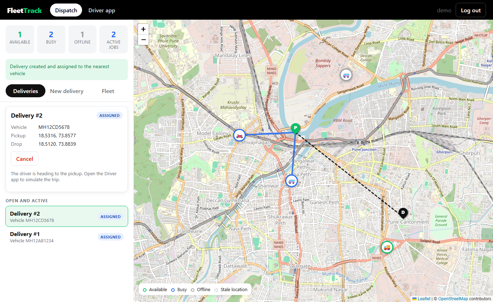
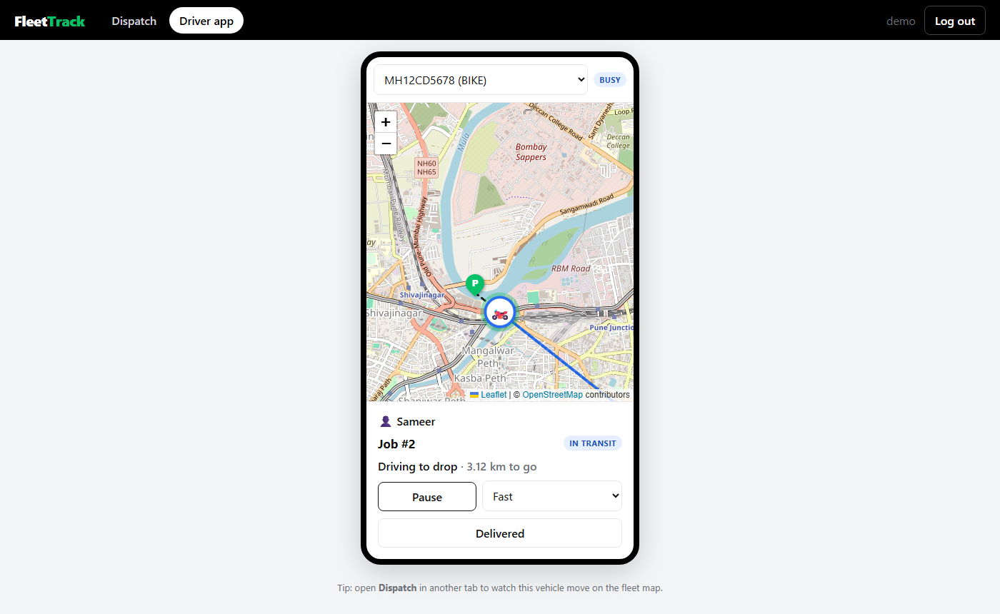

# FleetTrack UI

An Uber-style web interface for the FleetTrack backend (the Spring Boot app in the [parent folder](../README.md)): a **dispatcher console** with a live fleet map, and a phone-style **driver app** that simulates GPS so you can watch a delivery happen end to end.

**Stack:** React 19 · TypeScript · Vite · React Router · Leaflet / React-Leaflet (OpenStreetMap tiles) · Vitest

| Dispatcher console | Driver app |
|---|---|
|  |  |

## Features

**Dispatcher console** (`/`)
- Live map of the fleet, refreshed every 2 seconds. Pins are colored by status (green: available, blue: busy, grey: offline); a faded, dashed pin means the vehicle's location is stale (older than 15 minutes).
- Counters for available, busy and offline vehicles and active jobs.
- **New delivery:** click the map once for the pickup and once for the drop, choose an existing customer or enter a new one, and optionally auto-assign the nearest vehicle straight away.
- **Deliveries:** open and active jobs. For each you can auto-assign the nearest vehicle, pick one from the nearby list (with distances), or cancel. Lines on the map show each job's route and the vehicle's current leg.
- **Fleet:** every vehicle with its driver and status, plus a form to add vehicles.

**Driver app** (`/driver`)
- Choose the vehicle you are driving. The backend has no driver login, so this stands in for one.
- Go online or offline, and tap the map to set your position.
- New jobs from dispatch appear automatically.
- **Start trip (simulate GPS):** every second the vehicle moves towards the pickup and then the drop, sending real location updates and the status changes `PICKED_UP → IN_TRANSIT → DELIVERED` to the backend. Open Dispatch in another tab to watch it move.
- Manual buttons (Picked up, Start delivery, Delivered) if you'd rather not simulate.

## Running it

1. Start the FleetTrack backend on port 8080 (see the [main README](../README.md)).
2. Start the UI from this `frontend/` folder:
   ```bash
   cd frontend
   npm install
   npm run dev
   ```
3. Open http://localhost:5173 and sign in with a FleetTrack account.

During development, Vite proxies `/api` to `http://localhost:8080`, so the browser only ever talks to its own origin and the backend needs no CORS configuration. The proxy also drops the `Origin` header, because the backend rejects origins that aren't on its allow-list. To use a backend somewhere else, set `FLEETTRACK_API`:

```bash
FLEETTRACK_API=http://localhost:8081 npm run dev
```

## Scripts

| Command | What it does |
|---|---|
| `npm run dev` | dev server with hot reload on port 5173 |
| `npm test` | unit tests (Vitest): distance maths and the trip simulator |
| `npm run build` | type check and production build into `dist/` |

## How it works

- `src/api/client.ts` is a small typed `fetch` wrapper. It adds the JWT, turns backend error bodies into readable messages, and logs you out on any 401.
- `src/lib/usePolling.ts` refetches every few seconds and pauses while the tab is hidden. The backend has no push channel, so the UI polls.
- `src/lib/trip.ts` is the trip simulator as a pure function: given a job and a position, it returns the next position and any status changes. That keeps it unit-testable without a browser or backend.
- `src/components/FleetMap.tsx` is the shared Leaflet map. It draws vehicles, pickup and drop pins, and route lines.
- The session token is kept in `localStorage` so a refresh keeps you signed in. If storage is unavailable, you sign in again.

## Limitations

- It polls rather than receiving pushed updates; WebSockets on the backend would make it instant.
- Trips follow a straight line, not roads.
- The driver app has no login of its own; anyone signed in can act as any driver.
- There is no production deployment config yet. A static host needs a reverse proxy for `/api`, or CORS enabled on the backend with `CORS_ALLOWED_ORIGINS`.
